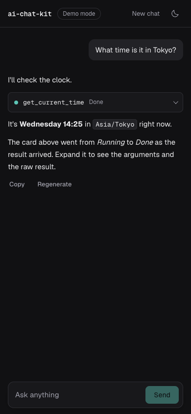

# ai-chat-kit

React + TypeScript components for streaming AI chat. The parts every chat UI needs and most get slightly wrong: token streaming, markdown with code blocks, tool-call cards, stop / retry / regenerate, auto-scroll that respects the reader, and screen-reader support that doesn't announce every token.


| Light | Dark | Mobile |
| --- | --- | --- |
|  |  |  |

## Why

I've built LLM chat UIs in production a few times. The model call is the easy part; the UI is where the bugs live:

- The view yanks you back to the bottom while you're trying to read an earlier paragraph.
- A screen reader reads out every 3-character chunk as it arrives.
- Stopping a reply leaves a tool spinner running forever.
- A failed tool call kills the whole message instead of showing up where it happened.

This kit is a small, readable answer to those. About 500 lines of source, two runtime dependencies (`react-markdown`, `remark-gfm`), 13 tests.

## Quick start

```bash
pnpm install
pnpm dev            # http://localhost:3000
```

With no API key the demo runs in **demo mode**: a scripted stream with markdown, a code block, a table, a successful tool call and a failing one. No network, no key.

To stream from a real model, copy `apps/demo/.env.example` to `apps/demo/.env.local`:

```bash
OPENAI_BASE_URL=https://api.openai.com/v1   # or OpenRouter, Groq, Ollama, LM Studio, vLLM...
OPENAI_API_KEY=sk-...
MODEL=gpt-4o-mini
OPENAI_TOOLS=on                              # "off" if your model has no tool calling
```

The key stays on the server (`app/api/chat/route.ts`); the browser only talks to `/api/chat`.

Other scripts: `pnpm test`, `pnpm typecheck`, `pnpm build`.

## Usage

```tsx
"use client";
import { Composer, MessageList, useChat } from "@ai-chat-kit/react";
import "@ai-chat-kit/react/styles.css";

export function Chat() {
  const chat = useChat({ api: "/api/chat" });
  return (
    <div style={{ display: "flex", flexDirection: "column", height: "100dvh" }}>
      <MessageList messages={chat.messages} status={chat.status} error={chat.error} onRegenerate={chat.regenerate} />
      <Composer status={chat.status} onSend={chat.send} onStop={chat.stop} />
    </div>
  );
}
```

Your endpoint receives `{ messages: { role, content }[] }` and responds with NDJSON, one event per line:

```jsonl
{"type":"text","delta":"Checking"}
{"type":"tool-call","id":"t1","name":"get_current_time","args":{"timezone":"Asia/Tokyo"}}
{"type":"tool-result","id":"t1","result":{"time":"14:22"}}
{"type":"tool-error","id":"t2","error":"Timed out"}
{"type":"error","message":"Rate limited"}
```

`apps/demo/lib/openai-stream.ts` shows how to translate an OpenAI-compatible SSE stream (including tool calls) into these events.

## API

| Export | Kind | What it does |
| --- | --- | --- |
| `useChat({ api, initialMessages?, body?, fetch? })` | hook | Returns `{ messages, status, error, send, stop, regenerate, setMessages }`. `status` is `idle`, `streaming`, `stopped` or `error`. |
| `<MessageList>` | component | Scrollable `role="log"`. Props: `messages`, `status`, `error?`, `onRegenerate?`, `renderToolCall?(call)`, `empty?`, `className?`. |
| `<Composer>` | component | Textarea + Send/Stop. Props: `status`, `onSend(text)`, `onStop()`, `placeholder?`, `autoFocus?`. |
| `<ToolCallCard call>` | component | Native `<details>` card for a tool call in `pending`, `result` or `error` state. |
| `<Markdown>` | component | GFM markdown with copyable code blocks. Raw HTML is not rendered. |
| `useAutoScroll(dep, threshold = 48)` | hook | `{ ref, atBottom, onScroll, scrollToBottom }` for your own scroll containers. |
| `applyEvent(parts, event)` | function | The pure reducer `useChat` uses. Handy for tests or a custom transport. |
| `ChatMessage`, `MessagePart`, `ToolCall`, `StreamEvent`, `ChatStatus` | types | |

Keyboard: <kbd>Enter</kbd> sends, <kbd>Shift</kbd>+<kbd>Enter</kbd> adds a line, <kbd>Esc</kbd> stops a running reply. IME composition is respected.

## Design notes

**Messages are ordered parts, not a string.** An assistant turn is `[text, tool, text]`, so a tool card renders exactly where the model called it and text that follows the result lands below it. A single `content` string can't express that.

**NDJSON over SSE.** The client is a plain `fetch` with a POST body and an `AbortSignal`. `EventSource` is GET-only, and SSE framing buys nothing once you're already reading a stream by hand. The server side stays trivial: `JSON.stringify(event) + "\n"`.

**Stop is just `AbortController`.** Aborting rejects the pending `reader.read()`, the partial text stays, and any tool still `pending` is marked `Stopped`, so nothing spins forever. The server sees `req.signal` abort and stops calling the model.

**Auto-scroll pins, it doesn't chase.** The list follows new content only while you're within 48px of the bottom. Scroll up and it lets go, and a "Jump to latest" button appears. Jumping is instant on purpose: a smooth scroll fires intermediate scroll events that would un-pin you mid-flight.

**Accessibility without the noise.** The log has `aria-live="off"` and `aria-busy` while streaming. A separate polite status region says "Assistant is responding", then reads the finished reply once (rendered text, so `**bold**` isn't read as asterisks). Tool cards are native `<details>`, so they're keyboard-operable for free, and errors use `role="alert"`. Everything has a visible focus ring, and animations stop under `prefers-reduced-motion`.

**Theming is CSS variables.** One stylesheet, `--ck-*` tokens, light and dark via `prefers-color-scheme` with a `data-theme` override. No CSS-in-JS runtime, no Tailwind requirement, and you restyle by overriding a handful of variables.

**Safe by default.** Markdown never renders raw HTML. The demo validates request bodies, caps message count and length, keeps the API key server-side, and doesn't echo upstream error bodies to the client.

**What's deliberately missing.** Syntax highlighting (add `rehype-highlight` or Shiki in your app if you want it), message editing, attachments and persistence. Each is easy to add on top and would double the size of the kit.

## Layout

```
packages/chat-kit   @ai-chat-kit/react: hooks, components, styles.css, tests (vitest + Testing Library)
apps/demo           Next.js App Router demo: /api/chat route, demo-mode script, OpenAI-compatible adapter
```

## License

MIT
