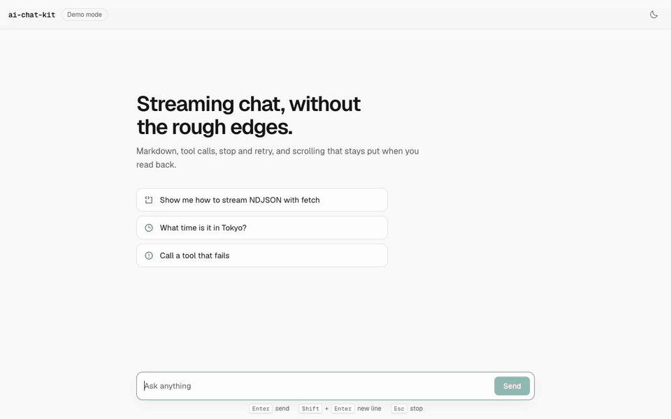
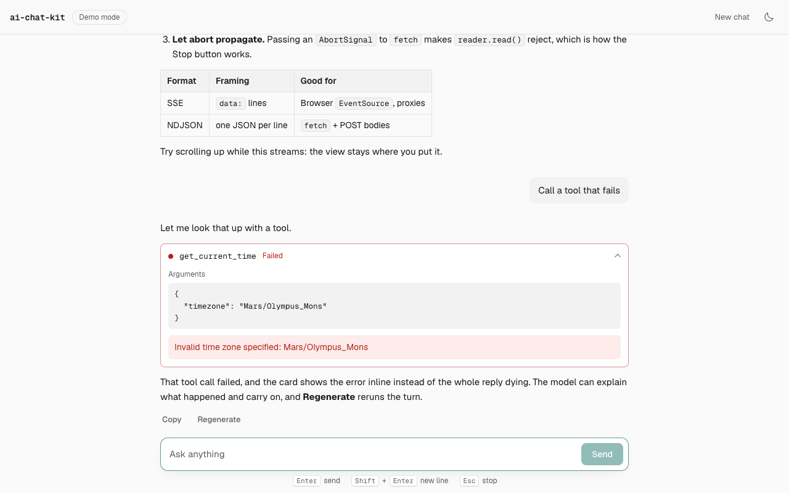
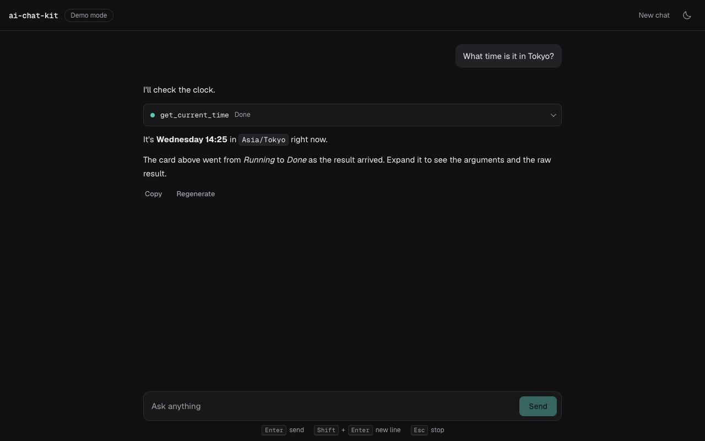
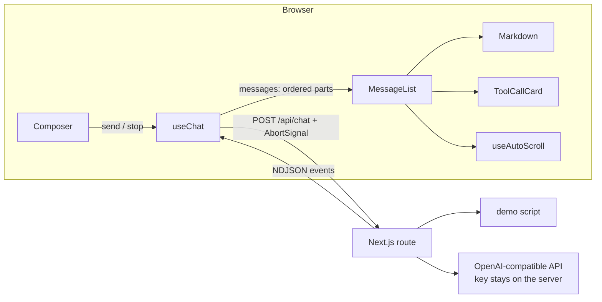

# ai-chat-kit

React components for streaming AI chat that handle the parts most chat UIs get slightly wrong: streaming, tool calls, stop and retry, scrolling and screen readers.

[](LICENSE)
[](packages/chat-kit/tsconfig.json)
[](packages/chat-kit/test)
[](packages/chat-kit/package.json)



| Light | Dark | Mobile |
| --- | --- | --- |
|  |  |  |

## Features

- **Token streaming** over NDJSON with a plain `fetch` and `AbortController`.
- **Markdown** (GFM) with copyable code blocks. Raw HTML is never rendered.
- **Tool-call cards** inline where the model called them, in pending, result or error state.
- **Stop, retry, regenerate.** Stopping keeps the partial text and cancels pending tools.
- **Auto-scroll that respects the reader:** follows new tokens only while you're at the bottom, with a "Jump to latest" button.
- **Accessible:** one screen-reader announcement per reply instead of one per token, keyboard support, visible focus, reduced motion.
- **Small:** about 500 lines of source, two runtime dependencies (`react-markdown`, `remark-gfm`), themed with CSS variables.

## Why

I've built LLM chat UIs in production a few times. The model call is the easy part; the UI is where the bugs live:

- The view yanks you back to the bottom while you're trying to read an earlier paragraph.
- A screen reader reads out every 3-character chunk as it arrives.
- Stopping a reply leaves a tool spinner running forever.
- A failed tool call kills the whole message instead of showing up where it happened.

## Quick start

Needs Node 20+ and [pnpm](https://pnpm.io).

```bash
git clone https://github.com/shubham-bodiwal/ai-chat-kit.git
cd ai-chat-kit
pnpm install
pnpm dev            # http://localhost:3000
```

With no API key the demo runs in **demo mode**: a scripted stream with markdown, a code block, a table, a successful tool call and a failing one. No network, no key.

To stream from a real model, copy `apps/demo/.env.example` to `apps/demo/.env.local`:

```bash
OPENAI_BASE_URL=https://api.openai.com/v1   # or OpenRouter, Groq, Ollama, LM Studio, vLLM...
OPENAI_API_KEY=sk-...
MODEL=gpt-4o-mini
OPENAI_TOOLS=on                              # "off" if your model has no tool calling
```

The key stays on the server (`app/api/chat/route.ts`); the browser only talks to `/api/chat`.

## Usage

```tsx
"use client";
import { Composer, MessageList, useChat } from "@ai-chat-kit/react";
import "@ai-chat-kit/react/styles.css";

export function Chat() {
  const chat = useChat({ api: "/api/chat" });
  return (
    <div style={{ display: "flex", flexDirection: "column", height: "100dvh" }}>
      <MessageList messages={chat.messages} status={chat.status} error={chat.error} onRegenerate={chat.regenerate} />
      <Composer status={chat.status} onSend={chat.send} onStop={chat.stop} />
    </div>
  );
}
```

Your endpoint receives `{ messages: { role, content }[] }` and responds with NDJSON, one event per line:

```jsonl
{"type":"text","delta":"Checking"}
{"type":"tool-call","id":"t1","name":"get_current_time","args":{"timezone":"Asia/Tokyo"}}
{"type":"tool-result","id":"t1","result":{"time":"14:22"}}
{"type":"tool-error","id":"t2","error":"Timed out"}
{"type":"error","message":"Rate limited"}
```

With `pnpm dev` running in demo mode, this is the real stream for the prompt "Call a tool that fails", without the `text` events:

```text
$ curl -sN localhost:3000/api/chat -H 'content-type: application/json' \
    -d '{"messages":[{"role":"user","content":"Call a tool that fails"}]}' | grep -v '"type":"text"'
{"type":"tool-call","id":"call_err","name":"get_current_time","args":{"timezone":"Mars/Olympus_Mons"}}
{"type":"tool-error","id":"call_err","error":"Invalid time zone specified: Mars/Olympus_Mons"}
```

The text arrives as small chunks (`{"type":"text","delta":"Let"}`, `{"type":"text","delta":" me lo"}`, ...) before and after them. A body that isn't a message list gets `400 {"error":"Invalid messages"}`.

`apps/demo/lib/openai-stream.ts` shows how to translate an OpenAI-compatible SSE stream (including tool calls) into these events.

## API

| Export | Kind | What it does |
| --- | --- | --- |
| `useChat({ api, initialMessages?, body?, fetch? })` | hook | Returns `{ messages, status, error, send, stop, regenerate, setMessages }`. `status` is `idle`, `streaming`, `stopped` or `error`. |
| `<MessageList>` | component | Scrollable `role="log"`. Props: `messages`, `status`, `error?`, `onRegenerate?`, `renderToolCall?(call)`, `empty?`, `className?`. |
| `<Composer>` | component | Textarea + Send/Stop. Props: `status`, `onSend(text)`, `onStop()`, `placeholder?`, `autoFocus?`. |
| `<ToolCallCard call>` | component | Native `<details>` card for a tool call in `pending`, `result` or `error` state. |
| `<Markdown>` | component | GFM markdown with copyable code blocks. Raw HTML is not rendered. |
| `useAutoScroll(dep, threshold = 48)` | hook | `{ ref, atBottom, onScroll, scrollToBottom }` for your own scroll containers. |
| `applyEvent(parts, event)` | function | The pure reducer `useChat` uses. Handy for tests or a custom transport. |
| `ChatMessage`, `MessagePart`, `ToolCall`, `StreamEvent`, `ChatStatus` | types | |

Keyboard: <kbd>Enter</kbd> sends, <kbd>Shift</kbd>+<kbd>Enter</kbd> adds a line, <kbd>Esc</kbd> stops a running reply. IME composition is respected.

## How it works



Each NDJSON line goes through `applyEvent`, a pure reducer that appends text or updates a tool call in place.

### Design notes

**Messages are ordered parts, not a string.** An assistant turn is `[text, tool, text]`, so a tool card renders exactly where the model called it and text that follows the result lands below it. A single `content` string can't express that.

**NDJSON over SSE.** The client is a plain `fetch` with a POST body and an `AbortSignal`. `EventSource` is GET-only, and SSE framing buys nothing once you're already reading a stream by hand. The server side stays trivial: `JSON.stringify(event) + "\n"`.

**Stop is just `AbortController`.** Aborting rejects the pending `reader.read()`, the partial text stays, and any tool still `pending` is marked `Stopped`, so nothing spins forever. The server sees `req.signal` abort and stops calling the model.

**Auto-scroll pins, it doesn't chase.** The list follows new content only while you're within 48px of the bottom. Scroll up and it lets go, and a "Jump to latest" button appears. Jumping is instant on purpose: a smooth scroll fires intermediate scroll events that would un-pin you mid-flight.

**Accessibility without the noise.** The log has `aria-live="off"` and `aria-busy` while streaming. A separate polite status region says "Assistant is responding", then reads the finished reply once (rendered text, so `**bold**` isn't read as asterisks). Tool cards are native `<details>`, so they're keyboard-operable for free, and errors use `role="alert"`. Everything has a visible focus ring, and animations stop under `prefers-reduced-motion`.

**Theming is CSS variables.** One stylesheet, `--ck-*` tokens, light and dark via `prefers-color-scheme` with a `data-theme` override. No CSS-in-JS runtime, no Tailwind requirement, and you restyle by overriding a handful of variables.

**Safe by default.** Markdown never renders raw HTML. The demo validates request bodies, caps message count and length, keeps the API key server-side, and doesn't echo upstream error bodies to the client.

**What's deliberately missing.** Syntax highlighting (add `rehype-highlight` or Shiki in your app if you want it), message editing, attachments and persistence. Each is easy to add on top and would double the size of the kit.

### Layout

```
packages/chat-kit   @ai-chat-kit/react: hooks, components, styles.css, tests (vitest + Testing Library)
apps/demo           Next.js App Router demo: /api/chat route, demo-mode script, OpenAI-compatible adapter
```

## Tests

```bash
pnpm test           # 13 tests (Vitest + Testing Library)
pnpm lint && pnpm typecheck && pnpm build
```

The tests drive the real components with a controllable `fetch`: streaming and settling, stop (partial text kept, pending tools cancelled), Escape and Shift+Enter, server errors and retry, regenerate, tool cards moving from pending to result or error, and auto-scroll pinning, un-pinning and re-pinning.

## Roadmap

- Publish `@ai-chat-kit/react` to npm.
- Optional syntax highlighting through a render prop.
- Message editing and attachments as opt-in components.
- Adapters in the demo for other providers' native streaming formats.

## Contributing

Issues and pull requests are welcome. See [CONTRIBUTING.md](CONTRIBUTING.md) for setup and checks, and the [Code of Conduct](CODE_OF_CONDUCT.md). Security issues: [SECURITY.md](SECURITY.md). Changes are listed in [CHANGELOG.md](CHANGELOG.md).

## License

[MIT](LICENSE) © Shubham Bhodiwal
